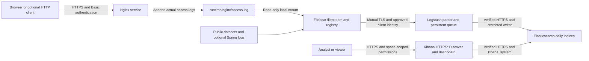

# Live ELK Stack lab

This university lab now runs a **real Nginx HTTPS service**. Browser requests or an optional request client cause Nginx to append real access logs. Filebeat continuously tails those files, Logstash authenticates the shipper, parses and buffers events, Elasticsearch indexes them, and Kibana displays current events with automatic refresh.

The original public Nginx/Apache datasets and optional Spring Boot input remain available. Live requests are controlled demo traffic, clearly tagged `log_origin: live`; they are not presented as public experimental datasets.



**Elastic version: 8.19.23 for every Elastic component.** See [LIVE.md](LIVE.md) for the complete security model, collection timing, outage demonstration and remote-host guidance. See [DEMO.md](DEMO.md) for the presentation walkthrough.

## Quick start

Run commands inside `elk-lab/`, not its parent directory. Paste only commands, without Markdown backticks or comment lines.

Requirements: Docker Engine/Desktop, Compose v2, Python 3, Bash, curl; at least 8 GiB RAM (16 GiB preferred) and 10 GiB free disk plus log/index growth. On Ubuntu only, configure `vm.max_map_count=262144` before startup. On macOS use Docker Desktop; the Ubuntu sysctl command does not apply directly to macOS.

```bash
cd elk-lab
python3 scripts/configure-env.py
docker compose --profile live config --quiet
docker compose --profile live up -d
docker compose ps -a
```

Skip `cd elk-lab` if already there. `configure-env.py` creates random credentials with file mode 600 for a fresh installation. It **never overwrites an existing `.env` or resets an existing password**. If you already have `.env`, preserve it; compare new keys against `.env.example`. This workspace's `.env` has already been configured.

`setup`, `init-users` and `kibana-setup` are one-shot containers: `Exited (0)` is expected. Other services should stay running. First startup may take several minutes. `kibana-setup` creates a dedicated **ELK Lab** space, Data View and live dashboard automatically.

The `live` profile enables the optional request client. Without it, Nginx still runs and logs your manual requests:

```bash
docker compose up -d
```

Omitting a profile does not stop an already running client. To pause that client explicitly:

```bash
docker compose stop traffic
```

## Open the services

| Service | Address | Account and password in `.env` |
|---|---|---|
| Nginx website | `https://localhost:8443` | `demo` / `WEB_PASSWORD` |
| Kibana lab space | `https://localhost:5601/s/lab` | `lab_analyst` / `LAB_ANALYST_PASSWORD` |
| Kibana viewer | Same lab space | `lab_viewer` / `LAB_VIEWER_PASSWORD` |
| Elasticsearch API | `https://localhost:9200` | Restricted human accounts for reading; `elastic` for administration |

These HTTPS endpoints use the private lab CA. Export its **public** certificate:

```bash
mkdir -p .local
docker compose cp es01:/usr/share/elasticsearch/config/certs/ca/ca.crt .local/ca.crt
```

Trust `.local/ca.crt` in the browser/profile used for the lab, then open the HTTPS URLs. Never import/share a private key or disable certificate verification globally. The verification scripts trust this CA explicitly. Certificates cover `localhost`, `127.0.0.1` and service DNS names, not arbitrary remote IPs. For Ubuntu accessed from your Mac, use SSH forwarding, e.g. `ssh -L 5601:127.0.0.1:5601 -L 8443:127.0.0.1:8443 user@ubuntu-host`, and use that host's public CA.

Open **Dashboard → ELK Live Service** in the lab space. It contains live request count, requests over time, HTTP-status distribution and an event table. Its saved time window is the last 15 minutes, with refresh every 5 seconds. In Discover select **ELK lab logs**, use `log_origin: "live"`, choose **Last 15 minutes**, and enable refresh. Dashboard objects were verified through the API; browser rendering still needs a visual check on your machine.

## Configuration and files

| File | Responsibility |
|---|---|
| `docker-compose.yml` | Service lifecycle, healthchecks, host ports, isolated key mounts, persistent volumes |
| `.env.example` / local `.env` | Version, credentials, memory limits, ports, traffic interval |
| `scripts/configure-env.py` | Generate fresh local secrets without overwriting existing configuration |
| `scripts/setup.sh` | Preserve existing CA/ES identity; issue service certificates and shipper identity; provision Nginx password hash |
| `scripts/init-users.sh` | Install index template, configure service writer and create missing human accounts |
| `scripts/init-kibana.sh` | Create space, scoped roles, Data Views and missing live dashboard |
| `scripts/setup-kibana.sh` | Explicitly rerun Kibana bootstrap if needed |
| `nginx/default.conf`, `nginx/html/` | Actual authenticated HTTPS service and web content |
| `runtime/nginx/` | Live access/error log files written by Nginx; gitignored |
| `scripts/traffic.py` | Make real HTTPS requests at a configurable interval; no synthetic log-file writes |
| `filebeat/filebeat.yml` | Source paths/metadata, multiline, registry, batching and mutual TLS |
| `logstash/logstash.yml` | Persistent queue, encrypted/authenticated loopback monitoring API, worker settings |
| `logstash/pipeline/logstash.conf` | Beats mutual TLS, client-identity allowlist, Grok/date parsing and HTTPS output |
| `elasticsearch/lab-template.json` | Date/source/tag/numeric mappings, one shard and zero replicas |
| `kibana/live-objects.json` | Pinned Kibana 8 dashboard, visualizations and saved search definitions |
| `scripts/verify.sh` | Cluster health, exact indexed counts, failures/success, samples and Kibana availability |
| `scripts/check-live.py` | Real request-to-search check and negative authentication/authorization tests |
| `scripts/demo-queue.py` | Explicit lab outage: observe queue growth, restore ES and reconcile source/index counts |
| `scripts/download-data.sh`, `scripts/extract_apache.py` | Authentic historical datasets, safe extraction and provenance |

## Source collection and processing

Live logs are outside `data/`: Nginx writes `runtime/nginx/access.log`; Filebeat sees it through a read-only mount at `/var/log/live-nginx/access.log`. Public inputs use `/logs/nginx/*.log` and `/logs/apache/*.log`. Optional Spring files use `/logs/spring/*.log`, with continuation lines joined to an ISO timestamp header. No authentic Spring dataset has been supplied, so actual Spring compatibility remains unverified.

Filestream reads appended lines continuously; its 1-second scanner interval discovers files. A 128-byte fingerprint identifies live files; tiny files wait until that size. Filebeat batches at most 128 events and flushes partial batches after about 1 second. This is near real time, not a guaranteed fixed latency. Elasticsearch's refresh makes indexed documents searchable; Kibana's refresh controls how often the screen queries them.

Every live event has `log_type: nginx`, `log_origin: live` and `service.name: nginx-live`. New public events have `log_origin: public_dataset`; previously ingested public documents remain unchanged and may lack this new field. Existing Filebeat IDs/registry and all stored data are preserved.

Logstash preserves `message` and `event.original`, parses HTTP fields, normalizes timestamps and records the authenticated TLS client subject. Apache timezone is assumed UTC when absent; Spring's fallback is `Asia/Ho_Chi_Minh`. Failures remain indexed with source-specific parse/date tags. Daily `lab-logs-yyyy.MM.dd` indices follow event timestamps. Data streams and ILM remain disabled: **no automatic retention**, so monitor disk and coordinate a retention policy with Huynh. Template changes apply to new indices; do not delete old data to apply mapping changes.

## Encryption, authentication and authorization

- Nginx: verified HTTPS, a dedicated web login, filesystem-path permissions, and `/private/` denied.
- Filebeat → Logstash: TLS server verification **and mandatory client certificate**, issued by a dedicated client CA. The filter allows only authenticated `CN=filebeat`.
- Logstash → Elasticsearch: verified HTTPS and `logstash_ingest`, restricted to `lab-logs-*` plus cluster monitoring.
- Elasticsearch transport: authenticated TLS; one-node discovery.
- Kibana → Elasticsearch: verified HTTPS and `kibana_system`; it is not a human login.
- Browser → Kibana: HTTPS and individual analyst/viewer logins. Both can read only `lab-logs-*`; neither can write/delete indices or manage users. Analyst can edit objects in **lab** space; viewer can only read them. Default/other spaces are not granted.
- Logstash monitoring: HTTPS plus a separate monitor login, bound to container loopback and not published.
- Setup alone mounts the signing-key volume; each service mounts only its own private identity and required public trust material. Filebeat reads log sources read-only.

Host ports bind to loopback. Secret values stay in gitignored `.env` and Docker's local container environment; do not publish expanded Compose configuration. This lab does not implement host-disk encryption, a secret manager or automatic certificate renewal. Container/Docker administrators remain trusted. Certificates expire after their issued lifetime; renew through a planned procedure rather than deleting CA volumes. See [LIVE.md](LIVE.md) for operational limits.

## Verify

```bash
docker compose config --quiet
bash scripts/verify.sh
python3 scripts/check-live.py
docker compose exec filebeat filebeat test config --strict.perms=false
docker compose exec filebeat filebeat test output --strict.perms=false
docker compose run --rm --no-deps logstash /usr/share/logstash/bin/logstash --config.test_and_exit -f /usr/share/logstash/pipeline/logstash.conf --path.data /tmp/logstash-config-check
```

`check-live.py` records actual checks in `reports/live-security.json` and exports the public CA to `.local/`. It uses a unique real HTTPS request to prove that a newly generated log becomes searchable. It does not reset credentials or delete data.

For an **intentional temporary Elasticsearch outage** in this lab only:

```bash
python3 scripts/demo-queue.py
```

It stops ES, leaves Nginx/Filebeat running for 20 seconds, measures queue growth, restarts ES, briefly pauses the optional request client to reconcile counts, and resumes it. Results go to `reports/queue-recovery.json`. Do not run it during another group member's demonstration. This tests outage buffering and recovery, not power-loss/crash durability or exactly-once delivery.

## Optional public datasets

```bash
bash scripts/download-data.sh
```

Already downloaded inputs are preserved; the downloader refuses to overwrite them. Sources: [Elastic Nginx example](https://github.com/elastic/examples/tree/master/Common%20Data%20Formats/nginx_logs) and [Loghub Apache error logs](https://github.com/logpai/loghub/tree/master/Apache), [full archive](https://zenodo.org/records/8196385/files/Apache.tar.gz?download=1). Preserve upstream attribution and consult dataset terms; cite [Loghub](https://github.com/logpai/loghub/blob/master/CITATION). `data/SOURCES.txt` records source URLs, retrieval and any appended final newline; `data/SHA256SUMS` checks the ingested files. No log text was fabricated.

Historical dataset counts/results are in [reports/RESULTS.md](reports/RESULTS.md). Use historical time windows for those logs: Apache 2005–2006, Nginx May–June 2015. Their 4,478 timestamp-free Apache lines are retained as failures with ingestion timestamps; they are not live application traffic.

## Troubleshooting and lifecycle

| Symptom | Action |
|---|---|
| Missing `.env.example`/Compose file | Run from `elk-lab/` |
| Shell displays `bquote>` | Ctrl+C; paste commands without Markdown backticks |
| Docker connection fails | Start Docker Desktop/Engine; check context and permissions |
| Certificate warning | Trust the exported public lab CA; use `localhost`; inspect expiry/identity rather than disabling TLS |
| Kibana appears empty | Enter `/s/lab`, select the lab Data View; filter live events and use Last 15 minutes |
| Viewer cannot edit dashboard | Expected; use `lab_analyst` for edits |
| New log not visible | Check complete newline, 128-byte live fingerprint threshold, Filebeat output and time range |
| Bootstrap failed | `docker compose logs --tail=100 setup init-users kibana-setup`; check new `.env` keys |
| ES OOM/bootstrap failure | Check Ubuntu sysctl, available RAM and container limits |
| Counts differ | Inspect files, registry, queue, failures, DLQ and source origin; do not clear persistent state |
| Password edited but login fails | Existing users persist; editing `.env` does not reset them. Coordinate an authorized rotation |

```bash
docker compose logs --tail=100 filebeat logstash nginx kibana
docker compose stop
docker compose start
```

Runtime services use `restart: unless-stopped`. On Ubuntu, Docker Engine must also start at boot; on Mac, Docker Desktop must be running. For recreation use `docker compose --profile live up -d`. Ordinary shutdown/restart preserves named volumes and source files. **Never use `down -v`, volume pruning, index deletion or registry deletion without explicit approval and a backup plan.** Source files and indices keep growing; the client can be paused when the demonstration is idle. Use rename-and-reopen log rotation, not copy/truncate.

## Academic handover and validation

Hung owns Filebeat/deployment/security/integration; Huy owns Grok/parsing/evaluation; Huynh owns Elasticsearch mapping/ILM; the fourth member owns Kibana/dashboard refinement. Advantages include continuous collection, structured search and visualizations; limitations include resource overhead, format-dependent parsing, duplicate risk and security administration. A single node offers no high availability.

The historical audit is in [REVIEW.md](REVIEW.md); historical dataset measurements are in [reports/RESULTS.md](reports/RESULTS.md). Current live-security and queue observations are in [reports/LIVE-RESULTS.md](reports/LIVE-RESULTS.md). Actual runtime tests use Docker Desktop ARM64; Ubuntu and browser rendering must be validated on the presentation machine. API-created dashboards are not claimed to have passed visual inspection.
